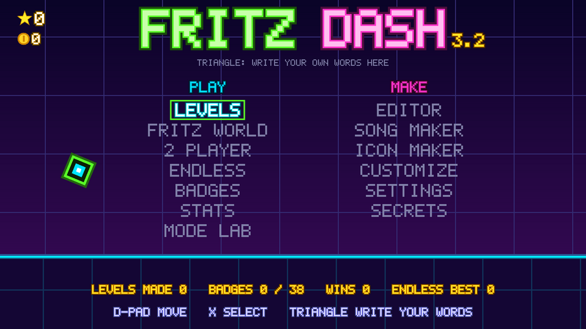
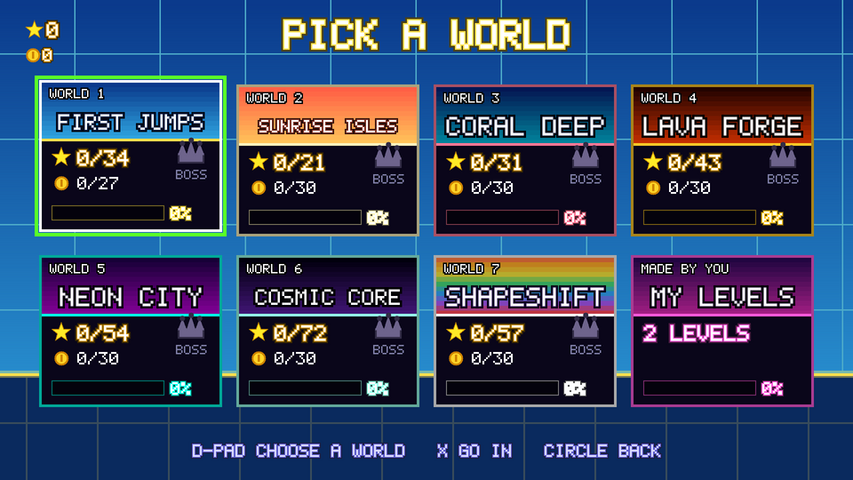
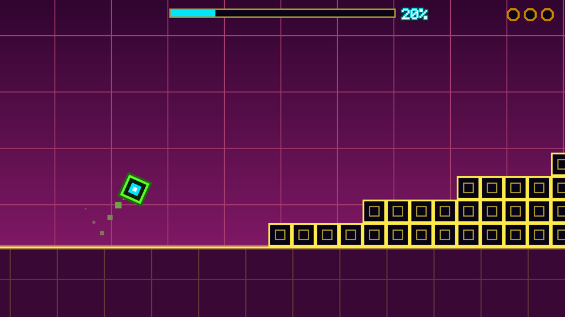
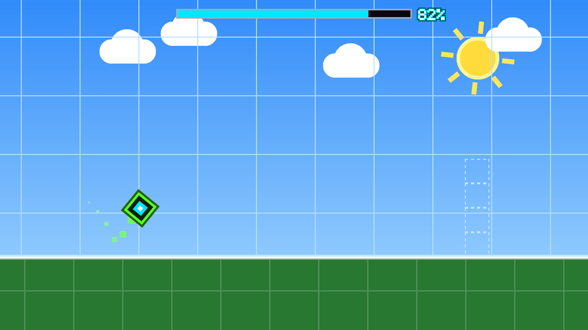
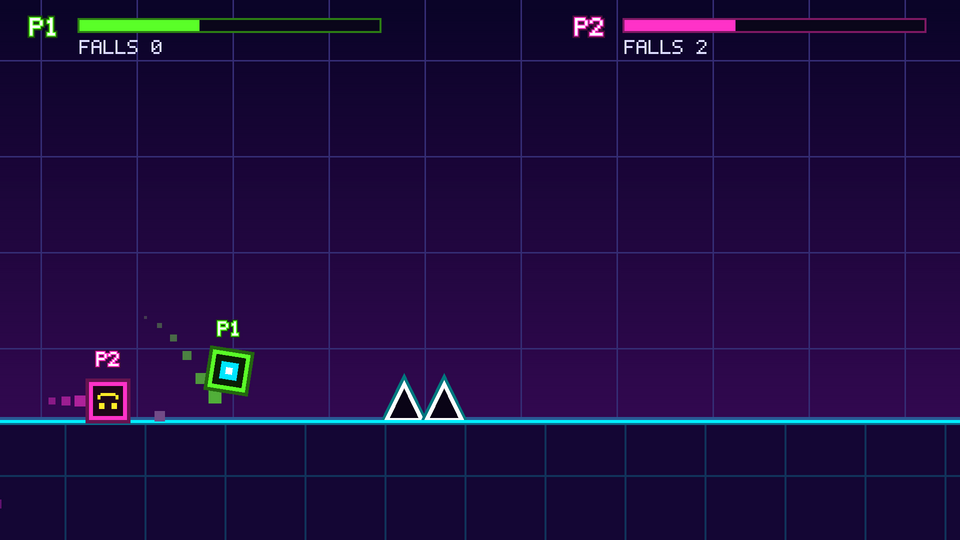
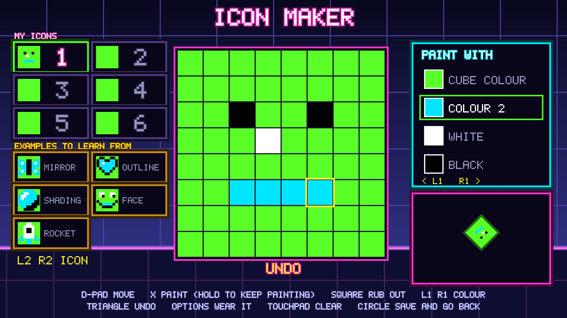

# Fritz Dash

A neon one-button platformer, made by Fritz and his dad.



**[Download Fritz Dash for Windows](../../releases/latest)**: one file, nothing to install.

## The story

Fritz has a favourite game, and it is Geometry Dash. A little square, a lot of spikes, music
that tells you when to jump, and the stubborn certainty that the next attempt will be the one.
Sooner or later every player of a game like that wonders what it would be like to have one of
their own. Fritz did more than wonder. He asked his dad, and the two of them set out to build it.

It began life on the family's PlayStation 4, as a home-made app. The very first version did
nothing at all. It showed one still picture and ignored every button, because a single line of
code was missing. When that line was found, the little square jumped, and there was no going back.

Levels came next, then a level editor, which quickly became the heart of the whole thing,
because a game you can build is better than a game you can only play. After that came a song
maker, an icon maker, ghosts of your best run and a two player race. Then Fritz handed over a
wish list: twenty or thirty ways to play, portals that change what you are in the middle of a
level, a hundred icons, two hundred secrets hidden in corners. Every item on that list is in the
game now. Fritz play-tested all of it.

Now Fritz Dash runs on Windows too, so he can play and build levels on his own computer. And
because good games are better shared, so can you.

## What's inside

- **74 levels in eight worlds:** First Jumps, Sunrise Isles, Coral Deep, Lava Forge, Neon City,
  Cosmic Core, Shapeshift and The Vault. Each level has three secret coins to find.
- **30 ways to play:** the cube, ship, ball, UFO and wave, plus robot, spider, swing, jetpack,
  bunny, pogo, frog, glider, grapple, drill, magnet, slime, surfer, skater, cannon, blaster and
  more. Try every one in the Mode Lab.
- **Transforming portals** that turn you into something else mid-level.
- **A level editor** with 20 save slots, ready-made pieces, a level map, moving groups,
  colour triggers and a Verify button that proves your level can be beaten.
- **A song maker** for your own music and **an icon maker** for your own face, plus 96
  ready-made icons and 8 pets.
- **255 easter eggs** to hunt for, collected in a book of secrets, and 38 badges.
- **A 2 player race** on one screen, ghosts of your best run, practice mode with checkpoints,
  Fritz World (your levels as a path to play through) and Endless mode.

There are no image or sound files anywhere in it. Every picture is drawn by the code and every
note is made by a little synthesiser while you play.

| | |
| --- | --- |
|  |  |
|  |  |
|  | |

## Play it on Windows

1. Download `FritzDash.exe` from the [latest release](../../releases/latest).
2. Double-click it. It starts full screen; F11 or Alt+Enter switches to a window.
3. Windows may say "Windows protected your PC", because the game is not signed by a big
   company. Click **More info**, then **Run anyway**.

A PS4 or Xbox controller works (plug it in any time), and so does the keyboard.
Your levels, songs, icons and progress are saved in `%APPDATA%\FritzDash`. To uninstall,
delete `FritzDash.exe`, and that folder too if you want to start over.

| Button | PS4 | Xbox | Keyboard |
| --- | --- | --- | --- |
| Jump, choose | X | A | Space or Z |
| Back | Circle | B | X or Backspace |
| Square | Square | X | C |
| Triangle | Triangle | Y | V |
| L1 / R1 | L1 / R1 | LB / RB | Q / E |
| L2 / R2 | L2 / R2 | LT / RT | 1 / 3 |
| Pause | Options | Start | Esc or Enter |
| Show me how | Touchpad | Back | Tab |
| Move | D-pad, left stick | D-pad, left stick | Arrow keys |
| Right stick | Right stick | Right stick | I J K L |

For the 2 player race, use two controllers, or one controller and the keyboard (the keyboard
is player 2).

## Build it yourself

### Windows (cross-compiled on Linux)

Tested on Ubuntu 24.04:

```bash
sudo apt install make clang python3 python3-pil gcc-mingw-w64-x86-64 zip curl
curl -LO https://github.com/libsdl-org/SDL/releases/download/release-2.32.10/SDL2-devel-2.32.10-mingw.tar.gz
tar xzf SDL2-devel-2.32.10-mingw.tar.gz
make BUILD=build SDL2_MINGW=$PWD/SDL2-2.32.10/x86_64-w64-mingw32 win win-zip
```

That makes `build/win/FritzDash.exe`, a single file with SDL2 built in, and a zip with the
exe and `README-PC.txt`. `FritzDash.exe --selftest <folder>` plays a short scripted run and
writes screenshots, which is handy for checking a build (`tools/win_smoke.sh` runs it under Wine).

### The simulator

```bash
make BUILD=build sim
```

This builds the whole game as a Linux program and checks it: the physics of every object, the
menus, the saved files, and a solver that plays every built-in level from start to finish to
prove it can be beaten. It must end with `SIM OK (0 failures)`. Screenshots land in `build/shots/`.

### PS4

Fritz Dash started as homebrew for a jailbroken PS4 with GoldHEN. With the
[OpenOrbis PS4 Toolchain](https://github.com/OpenOrbis/OpenOrbis-PS4-Toolchain) v0.5.4
(`OO_PS4_TOOLCHAIN` pointing at it), `make BUILD=build all` builds the `.pkg`.
`tools/verify_pkg.py` checks the result. Saves live in `/data/fritzdash`, in the same file
formats as on Windows, so levels can be copied between the two.

## Inside the code

| Where | What |
| --- | --- |
| `src/` | The game itself, shared by every platform |
| `src/pc_main.c` | Windows: window, controllers, keyboard and sound through SDL2 |
| `src/ps4_main.c` | PS4: video, pads and sound through the console's own libraries |
| `src/mode_*.c` | One file per way to play ([docs/MODES.md](docs/MODES.md)) |
| `levels/` | The built-in levels, drawn as text maps and turned into code by `tools/gen_levels.py` |
| `samples/` | The Mode Lab demo maps and a sample level |
| `tools/` | The simulator, the level solver and the build helpers |
| `docs/EGGS.md` | Every easter egg. Spoilers! |

## Thanks

- **Geometry Dash** by RobTop Games, the game that started it all. Fritz Dash is a fan-made
  tribute by a dad and his son. It is not affiliated with or endorsed by RobTop Games.
- **[SDL2](https://libsdl.org)** (zlib license) for windows, controllers and sound on PC.
- **[OpenOrbis](https://github.com/OpenOrbis/OpenOrbis-PS4-Toolchain)** for the PS4 toolchain.

## License

MIT. See [LICENSE](LICENSE).
